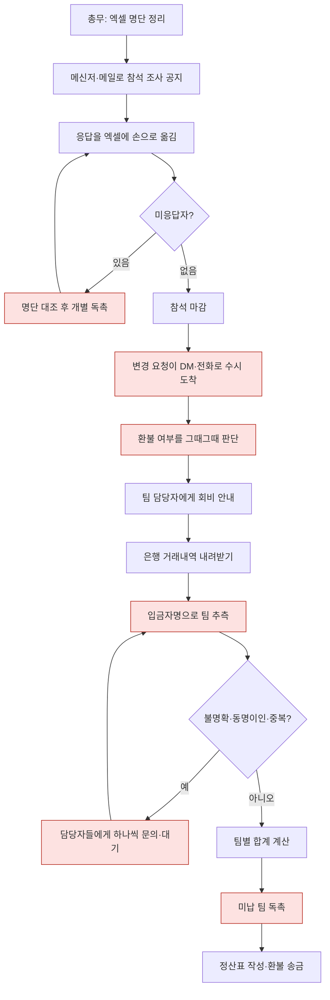
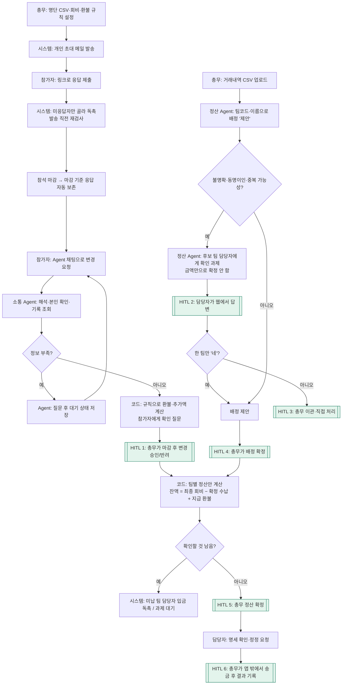

# 워크플로 — AI 적용 전·후와 사람의 개입 지점

발표용 flowchart 원본입니다(Mermaid, GitHub·VS Code 에서 바로 렌더링). draw.io 로 옮길 때 이 구조를 그대로 쓰면 됩니다. 소요 시간은 **추정**입니다(300명·25팀 기준, 실측 아님).

## 1. AI 적용 전 (As-Is)



병목·중복·오류 지점(붉은 칸)
- 응답·변경이 여러 채널로 흩어져 **엑셀 이중 입력**
- 마감 후 변경의 **환불 기준이 사람마다 다름**
- 입금자명 추측: 금액만 같으면 그 팀이라고 **잘못 확정**하기 쉬움
- 개인 입금과 팀 일괄 입금이 겹친 **중복 납부를 놓침**
- 독촉 대상 선별·발송을 매번 수작업

## 2. AI 적용 후 (To-Be)



## 2-1. 행사 후 정산: 마감 기준표 → 변동 기록 → 정산 보고서 (채총 시연 중심)

```mermaid
flowchart TD
  A[총무: 전체 명단 CSV 업로드\nID·이름·전화번호·Slack ID·소속 부서·팀 담당자] --> B[코드: 부서별로 팀 묶기 + 팀장 지정\n오류 행이 있으면 전체 반려]
  B --> C[Slack DM: 개인 인원조사]
  C --> D[(① 참석 마감: 사람별 응답 기준표)]
  D --> E[담당자: 부서 회비를 한 번에 걷어 입금]
  E --> F[(② 납부 마감: 부서별 청구표)]
  F --> G[변동 기록: 마감 후 변경 · 행사 당일 변동(총무 입력) · 늦은 입금]
  G --> H[정산 Agent: 기준표 + 변동 기록 대조\n보고서 새 버전 + 이전 버전과 차이]
  H --> I{부서 상태}
  I -- "+ 추가 납부" --> J[[HITL: 총무가 '네' → 담당자에게만 추가 납부 안내 DM]]:::hitl
  I -- "− 환불" --> K[[HITL: 총무가 '네' → 담당자에게만 환불 안내 DM → 송금 후 기록]]:::hitl
  I -- 확인 필요 --> L[[HITL: 당일 불참 환불액 결정 · 배정 확정 · 과제 처리]]:::hitl --> H
  M[총무: '경영지원팀 추가 회비 납부자 알려줘'] --> N[총무 Agent: 보고서 조회 도구 선택\n숫자는 보고서에서만] --> M
  classDef hitl fill:#e3f4ec,stroke:#13795b
```

| 비교 | AI 적용 전 | AI 적용 후 |
|---|---|---|
| 행사 후 대조 | 엑셀 명단·은행 내역·메신저 변경 요청을 나란히 놓고 300명을 한 줄씩 비교 | 보고서 한 장: 부서별 청구액·최종 회비·입금·잔액 + 달라진 사람만 근거와 함께 |
| 기준 | "그때 얼마 내라고 했더라?"를 기억·메시지로 추적 | 마감 때 저장한 청구표(수정 안 됨)와 비교 |
| 질문 | 필터·정렬을 직접 | "경영지원팀의 추가 회비 납부자를 알려줘" → 이름·금액·사유 |
| 연락 | 환불 대상 개인을 찾아 각각 연락 | 부서 담당자에게만, 총무 확인 후 한 번에 |

## 3. 사람의 개입 지점 (HITL)
| # | 누가 | 무엇을 | 왜 사람이 |
|---|---|---|---|
| 1 | 총무 | 마감 후 변경 승인/반려 | 버스 좌석·식사 등 실제 비용이 확정된 뒤의 판단, 규칙 없는 예외 |
| 2 | 담당자 | 입금 확인 질문에 답변 | 팀 내부에서 누가 냈는지는 담당자만 앎 |
| 3 | 총무 | 이관된 과제 처리(모두 '아니요', 여러 팀 '네', 이자 등) | 근거가 부족해 Agent 가 확정하면 안 되는 경우 |
| 4 | 총무 | Agent 배정 제안 확정 | 돈의 귀속 확정 책임 |
| 5 | 총무 | 팀별 정산 확정 | 미확정 응답·승인 대기·미확정 배정이 남으면 코드가 막음 |
| 6 | 총무 | 송금 결과 기록 | 실제 송금은 앱 밖(은행) |
| 7 | 총무 | 총무 Agent 의 담당자 안내 발송 '네' | 돈 안내가 실제 사람에게 나감 |
| — | 참가자 | 변경 내용 '네' 확인 | 대화만으로 기록이 바뀌지 않게 |

## 4. 전·후 비교 (추정)
| 항목 | AI 적용 전 | AI 적용 후 |
|---|---|---|
| 총무가 직접 하는 단계 | 약 15단계(입력·대조·문의·계산·독촉) | 설정·업로드·승인·확정 중심 6단계 |
| 응답 취합 | 메신저→엑셀 수기 입력 | 참가자가 직접 제출, 자동 집계 |
| 독촉 | 명단 대조 후 개별 연락 | 대상 자동 선별, 발송 직전 재검사·금지 시간·하루 한도 |
| 변경·환불 | 건별 판단 | 시점·항목별 규칙을 코드가 계산, 총무는 승인 |
| 입금 대조 | 입금자명 추측, 금액 일치로 확정 | 근거 있는 제안 + 불명확하면 담당자 질문, 금액만으로 확정 금지 |
| 오류 가능 지점 | 이중 입력, 환불 기준 불일치, 중복 납부 누락, 오배정 | 규칙·데이터 입력 오류(설정 단계)로 축소 |
| 근거 추적 | 메신저 기록 뒤지기 | 변경 이력·근거 메시지·사용 규칙·Agent 실행 기록 |

## 5. 시연 시나리오(시드 데이터)
1. 총무 대시보드 → '지금 사람이 볼 것'
2. 참가자(개발용 수신함 링크) → “못 가게 됐어요” → 50% 환불 확인 → 승인 대기
3. 총무 '변경 승인' → 승인 → 정산 반영
4. 입금 대조: high 제안 일괄 확정 / ‘ㅎㅂ’ 입금은 금액 일치 후보 팀에 질문만
5. T05·T17 담당자: 동명이인 ‘김민준’ 입금 질문 → 한 팀만 '네' → 배정 제안 → 총무 확정
6. T13 담당자: 개인+팀 중복 납부 확인 → 정산 잔액 −20,000원(추가 환불)
7. 2차 CSV 업로드(중복 행 건너뜀) → 정산 Agent 재점검 → T24 제안
8. 입금 독촉 생성·발송 → 개발용 수신함 / 반송 주소 재시도
9. 정산 확정 → 환불 송금 기록 → 잔액 0
